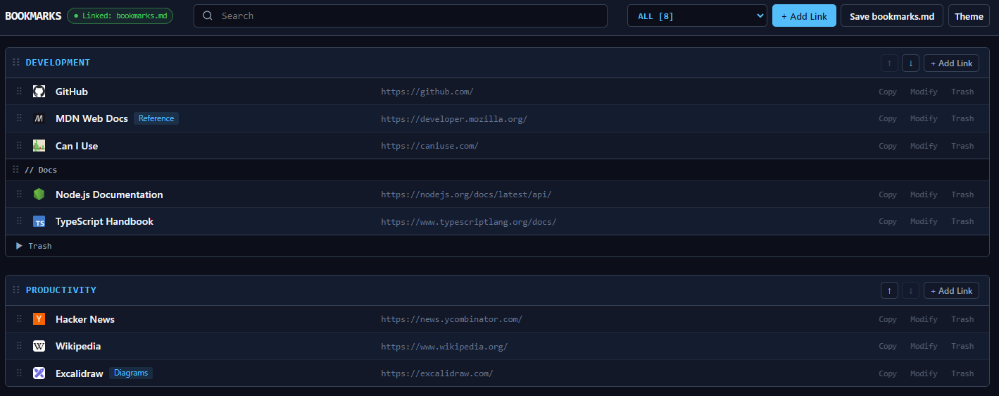

# Bookmarks

A lightweight, single-page bookmark dashboard backed by a plain Markdown file (`bookmarks.md`). Works directly by opening `index.html` via `file://` with no build step or dependencies, and supports saving edits back to disk via the File System Access API or an optional local Node.js helper (`server.js`).



## Features

- **Zero-build & offline-ready**: Open `index.html` directly in any modern browser (`file://`), or serve it locally.
- **Markdown-backed storage**: All bookmarks live in `bookmarks.md` using standard Markdown headings (`## Category`, `### Subcategory`) and links (`- [Title](https://...) - note`).
- **Instant search & category filtering**:
  - Search across titles, URLs, notes, categories, and subcategories.
  - Filter by category via the header dropdown, `?category=<name>` / `?cat=<name>` URL parameters, or `#<category>` URL hash.
- **Add, edit & organize in the UI**:
  - **Add / Modify modal** (`+ Add Link` or `Ctrl/Cmd + B`) to create or edit bookmarks in place, create new categories, or move links between categories/subcategories (auto-fills title from hostname if left blank).
  - **Drag-and-drop reordering** (`⋮⋮`) for links (within or across categories), categories, and subcategories (plus `↑` / `↓` buttons).
  - **Collapsible Trash / Temp / Archive drawer**: Subcategories named `Trash`, `Temp`, or `Archive` are automatically pinned to the bottom of each category inside a collapsible `<details>` drawer, with one-click **Restore** or **Delete**.
- **Link opening behavior**: Clicking a bookmark **title** opens in a new tab (`target="_blank"`); clicking the **URL** opens in the current tab.
- **Automatic favicons**: Fetches domain icons via Google's favicon service (`https://www.google.com/s2/favicons?domain=<hostname>&sz=32`) with an automatic fallback to a built-in SVG globe icon when offline or for internal hosts.
- **Dark & light themes**: Toggleable theme persisted in `localStorage`.

## Quick Start

1. Clone or download the repository.
2. Open `index.html` in your browser.
3. Add or edit bookmarks either:
   - Directly in `bookmarks.md` (with any text editor or AI) and refreshing `index.html`, or
   - Through the web UI and saving back to `bookmarks.md`.

### Saving Changes to `bookmarks.md`

The UI supports three ways to persist changes:

1. **Optional local Node.js server (recommended for automatic saving)**:
   ```bash
   node server.js
   ```
   Starts a zero-dependency helper on `http://127.0.0.1:17380`. Works both when visiting `http://localhost:17380` and when opening `index.html` via `file://`, automatically writing every change to `bookmarks.md`.

2. **Browser File System Access API**:
   Click **Link bookmarks.md** in the header (or **Save bookmarks.md** / `Ctrl/Cmd + S`) to grant write access to `bookmarks.md` once (persisted via IndexedDB in supported Chromium browsers).

3. **Clipboard fallback**:
   If neither `server.js` nor the File System Access API is available, clicking **Save bookmarks.md** copies the full `bookmarks.md` content to your clipboard.

## Keyboard Shortcuts

| Shortcut | Action |
| --- | --- |
| `/` or `Ctrl/Cmd + K` | Focus search |
| `Enter` (in search) | Open first matching bookmark in a new tab |
| `Escape` | Clear search / close open modal |
| `Ctrl/Cmd + B` | Open Add Bookmark modal |
| `Ctrl/Cmd + S` | Save to `bookmarks.md` |

## Bookmark Format (`bookmarks.md`)

`bookmarks.md` wraps standard Markdown inside `window.BOOKMARKS_MD = String.raw\`...\`;` so `index.html` can load it via `<script src="bookmarks.md">` over `file://` without CORS restrictions (and also supports standard `fetch("bookmarks.md")` when served over HTTP):

```markdown
## Category Name

- [Link Title](https://example.com)
- [Link Title](https://example.com) - Optional note

### Subcategory Name

- [Subcategory Link](https://example.com/docs) - Docs

### Trash

- [Archived Link](https://example.com/old)
```

## Files

- **`index.html`** — Complete single-file UI, CSS, Markdown parser/serializer, search, theme toggle, modal forms, and drag-and-drop logic.
- **`bookmarks.md`** — Your bookmarks data in Markdown format (includes a small set of starter example links).
- **`server.js`** — Optional zero-dependency local Node.js server (`127.0.0.1:17380`) for serving the app and auto-saving directly to `bookmarks.md`.

## License

[MIT](LICENSE)
